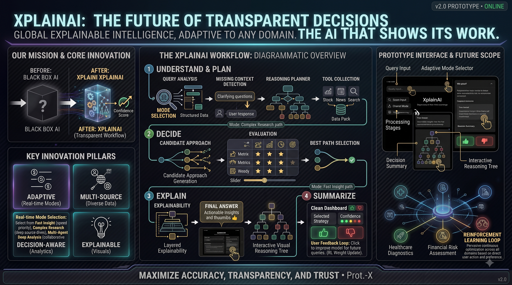

<div align="center">

# 🔍 XplainAI

### *Explainable AI Reasoning Engine — See Every Step of AI Thinking*

[](https://python.org)
[](https://fastapi.tiangolo.com)
[](https://langchain-ai.github.io/langgraph/)
[](https://react.dev)
[](https://vite.dev)
[](LICENSE)

**XplainAI** is a full-stack Explainable AI (XAI) platform that doesn't just answer questions — it shows you **why** and **how** it reached that answer. Every decision is transparent, auditable, and interactive.



</div>

---

## 🧠 The Core Idea

Most AI chatbots are black boxes. You ask a question, you get an answer — no insight into the reasoning.

XplainAI breaks that mold. Inspired by how expert humans reason, it runs a **multi-stage, multi-agent LangGraph pipeline** where every step is:
- **Streamed live** to the frontend (Server-Sent Events)
- **Visualised** as a reasoning tree (React Flow + D3)
- **Explained** in plain language — why this answer, why not others

---

## ✨ Features

| Feature | Description |
|---|---|
| 🔄 **Multi-Stage Reasoning Graph** | 12-node LangGraph pipeline: query analysis → evidence gathering → candidate generation → evaluation → selection → answer → explainability |
| 📡 **Real-Time Streaming** | Every pipeline stage is streamed via SSE; the UI updates live as the AI "thinks" |
| 🌳 **Interactive Reasoning Tree** | React Flow canvas shows all candidate approaches, the selected path, and why others were rejected |
| 📄 **RAG (Document QA)** | Upload PDF, DOCX, PPTX, MP3, MP4 — they are chunked, embedded (Gemini Embeddings + FAISS), and used as context |
| 🔬 **Research Agent** | In `complex` mode, searches arXiv, PubMed, IEEE, and other academic sources and summarises findings |
| 🛠️ **Live Tool Calling** | Web search (DuckDuckGo), stock prices (Alpha Vantage), weather (OpenWeatherMap), news (NewsData.io), calculator |
| 💬 **Clarification Interrupts** | If the query is ambiguous, the graph pauses (LangGraph `interrupt`) and asks the user targeted follow-up questions |
| 👍 **Reinforcement Learning from Feedback** | Thumbs up/down on responses; the LLM extracts PREFER/AVOID rules and injects them into future answers for that session |
| 🔁 **Reverse Mind Mode** | Forces the AI to ignore RL preferences — useful for debugging or exploring unbiased answers |
| 📝 **Persistent History** | SQLite stores all conversations and full graph state per message |
| 🗑️ **Conversation Management** | Create, switch, delete conversations from a sidebar |
| 📤 **Export** | Export XAI report as PDF |

---

## 🏗️ Architecture

```
┌─────────────────────────────────────────────────────────────────┐
│                         FRONTEND (React + Vite)                  │
│  ┌──────────────┐  ┌──────────────┐  ┌───────────────────────┐  │
│  │HistorySidebar│  │   ChatArea   │  │       XAIPanel        │  │
│  │  (SQLite via │  │ (SSE stream, │  │ (Explainability,      │  │
│  │   REST API)  │  │  Markdown,   │  │  ReasoningTree,       │  │
│  │              │  │  Clarif. UI) │  │  Evidence, Summary)   │  │
│  └──────────────┘  └──────────────┘  └───────────────────────┘  │
└──────────────────────────────┬──────────────────────────────────┘
                               │ HTTP / SSE
┌──────────────────────────────▼──────────────────────────────────┐
│                    BACKEND (FastAPI + LangGraph)                  │
│                                                                   │
│  POST /api/chat          → create conversation                   │
│  GET  /api/chat/stream   → SSE: run LangGraph, stream stages    │
│  POST /api/upload        → store file for RAG                   │
│  POST /api/chat/resume   → answer clarification questions        │
│  GET  /api/chat/resume_stream → SSE: resume interrupted graph   │
│  POST /api/chat/feedback → RL thumbs up/down                    │
│  GET  /api/history       → list all conversations               │
│  GET  /api/conversation  → load single conversation             │
│  DELETE /api/conversation→ delete conversation                  │
│                                                                   │
│  ┌────────────────────────────────────────────────────────────┐  │
│  │                   LangGraph Pipeline                        │  │
│  │                                                             │  │
│  │  START → [query_analysis] → [missing_context_detector]     │  │
│  │       → [reasoning_evidence_planner] → [source_selection]  │  │
│  │                           ↓ (conditional)                  │  │
│  │          ┌────────────────┼────────────────┐               │  │
│  │      [rag_node]    [tool_execution]  (skip)                │  │
│  │          └────────────────┤                                │  │
│  │                  [evidence_aggregation]                     │  │
│  │                           ↓ (conditional)                  │  │
│  │               ┌───────────┴────────────┐                   │  │
│  │         [research_node]        [candidate_generation]       │  │
│  │               └───────────┬────────────┘                   │  │
│  │                  [candidate_generation]                     │  │
│  │                  [evaluation]                               │  │
│  │                  [select_best]                              │  │
│  │                  [final_answer]                             │  │
│  │                  [explainability]                           │  │
│  │                  [reasoning_tree]                           │  │
│  │                  [summary] → END                            │  │
│  └────────────────────────────────────────────────────────────┘  │
│                                                                   │
│  Persistence:  reasonlens.db (SQLite, conversations+messages)    │
│                graph_state.db (AsyncSqliteSaver, LangGraph state) │
└─────────────────────────────────────────────────────────────────┘
```

---

## 🔬 LangGraph Pipeline — Node-by-Node

### 1. `query_analysis`
**What it does:** Breaks down the incoming query into structured metadata.

**Output fields:** `intent`, `domain`, `query_type`, `complexity`, `ambiguity`, `entities`, `keywords`, `required_knowledge`, `reasoning_type`, `risk_level`, `confidence`, `analysis_summary`

**Why:** Downstream nodes use this structured analysis to make smarter decisions (e.g., the planner uses `complexity` to decide whether to run tools or research).

---

### 2. `missing_context_detector`
**What it does:** Detects if the query is under-specified and needs clarification.

**Logic:**
- Uses the `ambiguity` flag from query analysis as the primary signal
- Also applies domain heuristics (e.g., stock queries need a symbol, weather needs a city, medical queries need patient details)
- If clarification needed → calls `interrupt(questions)`, which **pauses the LangGraph graph** and sends the questions to the frontend via SSE
- When the user answers, the `/api/chat/resume` + `/api/chat/resume_stream` endpoints inject answers back via `Command(resume=answers)`
- The augmented query (`original + user answers`) then flows through the rest of the graph

**Key rule:** If a document was uploaded, never asks the user to re-provide it.

---

### 3. `reasoning_evidence_planner`
**What it does:** Decides the **strategy** before gathering evidence.

**Output:** `query_complexity`, `reasoning_strategy`, `selected_tools` (with priority, expected contribution, trust score), `ignored_tools`, `minimum_evidence_sources`, `candidate_approaches` count, `expected_confidence`, `planning_summary`

**Why this design:** By planning first, downstream tool execution is selective and purposeful — only tools that add meaningful value are called.

---

### 4. `source_selection`
**What it does:** Identifies which knowledge sources are appropriate (LLM knowledge, web search, Wikipedia, research papers, GitHub, etc.) and assigns priority + confidence scores.

**Conditional routing after this node:**
- `document_uploaded=True` → also run `rag_node`
- `mode=fast` → skip tools, go straight to evidence aggregation
- Query complexity ≠ Simple → run `tool_execution`

---

### 5. `rag_node` *(conditional)*
**What it does:** Retrieval-Augmented Generation for uploaded documents.

**Supported formats:** PDF, DOCX, PPTX, MP3, WAV, MP4, MOV, AVI, MKV, M4A

**Logic:**
- Loads document with the appropriate LangChain loader
- For audio/video: extracts audio with MoviePy → transcribes with OpenAI Whisper
- Splits into chunks (1000 tokens, 200 overlap) using `RecursiveCharacterTextSplitter`
- Embeds with **Google Gemini Embeddings** (`gemini-embedding-2-preview`)
- Stores in FAISS vector store (cached in memory per document path)
- Retrieves top-4 similar chunks for the user query

---

### 6. `tool_execution` *(conditional)*
**What it does:** Calls real-world APIs based on the planner's selected tools.

**Available tools:**
| Tool | API | Purpose |
|---|---|---|
| `DuckDuckGoSearchResults` | DuckDuckGo | General web search |
| `get_stock_price` | Alpha Vantage | Live stock quotes (supports `.BSE` suffix for Indian stocks) |
| `get_weather` | OpenWeatherMap | Current weather by city |
| `get_news` | NewsData.io | Latest news articles |
| `calculator` | Built-in | Arithmetic operations |

**Logic:** The planner's `selected_tools` list maps to actual tool objects via `PLANNER_TOOL_MAP`. If the planner selected specific tools, `tool_choice="any"` forces the LLM to call at least one.

---

### 7. `evidence_aggregation`
**What it does:** Consolidates raw tool outputs + RAG context into a structured evidence list.

**Output per evidence piece:** `source`, `title`, `summary`, `url`, `trust_score`, `relevance_score`

**Conditional routing after this node:**
- `mode=complex` AND `query_complexity=Complex` → run `research_node` first
- Otherwise → go directly to `candidate_generation`

---

### 8. `research_node` *(complex mode only)*
**What it does:** Searches academic sources for peer-reviewed evidence.

**Scope:** Searches are scoped to: `arxiv.org`, `pubmed.ncbi.nlm.nih.gov`, `scholar.google.com`, `ieeexplore.ieee.org`, `dl.acm.org`, `link.springer.com`, `sciencedirect.com`, `nature.com`

**Output:** `core_topic`, `key_findings` (with title, summary, URL), `agreements`, `contradictions`, `evidence_summary`

---

### 9. `candidate_generation`
**What it does:** Generates N independent candidate approaches to answer the query.

**N** is determined by the planner (`candidate_approaches`, default 5). Each approach has: `approach_id`, `title`, `description`, `reasoning_type`, `advantages`, `disadvantages`, `estimated_confidence`

**Why multiple approaches?** This models expert reasoning — good thinkers consider multiple strategies before committing to one.

---

### 10. `evaluation`
**What it does:** Independently scores every candidate approach on 5 dimensions:
- **Feasibility Score** (0-100)
- **Relevance Score** (0-100)
- **Completeness Score** (0-100)
- **Source Support Score** (0-100)
- **Overall Score** (0-100)

Also identifies strengths, weaknesses, assumptions, and limitations per approach.

---

### 11. `select_best`
**What it does:** Picks the single best approach based on evaluation scores.

**Output:** `selected_approach` (id, title, selection reason, overall confidence) + `rejected_approaches` with explicit rejection reasons.

---

### 12. `final_answer`
**What it does:** Generates the actual answer using **only** the selected approach.

**RL Profile Injection:** If a Reinforcement Learning profile exists for this conversation (built from thumbs up/down), it is injected into the system prompt as PREFER/AVOID rules — unless `reverse_mind=True`.

**Citation logic:** If evidence or research findings contain relevant facts, the LLM cites them inline with source name and URL. Invented URLs are explicitly forbidden.

---

### 13. `explainability`
**What it does:** Generates a human-readable explanation of the entire decision process.

**Output:** `why_this_answer`, `why_selected`, `why_other_approaches_not_selected`, `sources_used`, `key_decision_factors`, `confidence_score`, `confidence_reason`, `assumptions`, `uncertainties`, `limitations`, `risk_level`, `verification_suggestion`, `follow_up_questions`, `decision_flow`

---

### 14. `reasoning_tree`
**What it does:** Generates the data structure for the interactive React Flow visualisation.

**Output:** `root` node (user query) → `nodes` (all candidate approaches, with selected/rejected status) → `final_node` (connected only to selected approach)

---

### 15. `summary`
**What it does:** Generates a concise executive summary of the entire AI decision.

**Output:** `selected_approach`, `why_selected`, `confidence`, `sources_used`, `key_decision_factors`, `limitations`, `risk_level`, `verification_suggestion`, `final_answer`

---

## 🔁 Reinforcement Learning from Human Feedback (RLHF)

XplainAI implements a lightweight, session-scoped RLHF loop:

1. User clicks 👍 or 👎 on any AI response
2. The backend calls the LLM with the message text and the feedback type
3. The LLM extracts a **1-sentence preference rule** (`PREFER: ...` or `AVOID: ...`)
4. This rule is appended to an in-memory **RL profile** for that conversation
5. On the next query, the RL profile is injected into the `final_answer` system prompt

**Reverse Mind Mode:** Toggle this to bypass the RL profile and get a "clean" answer — useful for comparison.

---

## 🗄️ Data Persistence

### `reasonlens.db` — Conversation Storage
```sql
conversations(id TEXT PRIMARY KEY, created_at TEXT)
messages(id INTEGER, conversation_id TEXT, role TEXT, content TEXT,
         full_state TEXT, created_at TEXT)
```
`full_state` stores the **entire LangGraph state as JSON** — so you can replay and inspect any past reasoning trace.

### `graph_state.db` — LangGraph Checkpointing
Uses `AsyncSqliteSaver` to persist LangGraph graph state. This enables the **interrupt/resume** flow for clarification questions — the graph is paused, state is saved, and resumed later with user answers.

---

## 📁 Project Structure

```
XplainAI/
├── .env.example              # Template for environment variables (copy to .env)
├── .gitignore
├── XPLAINAI.png              # App screenshot/logo
│
├── backend/
│   ├── main.py               # FastAPI app, all API endpoints, SSE streaming
│   ├── graph.py              # LangGraph pipeline (15 nodes, all AI logic)
│   ├── database.py           # SQLite CRUD for conversations & messages
│   └── requirements.txt      # Python dependencies
│
├── frontend/
│   ├── index.html
│   ├── package.json
│   ├── vite.config.js
│   └── src/
│       ├── main.jsx          # React entry point
│       ├── App.jsx           # Root component
│       ├── index.css         # Global styles
│       └── components/
│           ├── AppShell.jsx      # Layout, routing, state management
│           ├── ChatArea.jsx      # Chat UI, SSE consumer, message rendering
│           ├── XAIPanel.jsx      # Explainability panel (sources, decisions, etc.)
│           ├── ReasoningTree.jsx # React Flow reasoning tree visualisation
│           └── HistorySidebar.jsx# Conversation history list
│
└── notebooks/
    ├── backend_backup.ipynb           # Prototype/research notebook
    └── backend_with_rag_research.ipynb# RAG + research agent experiments
```

---

## 🚀 Quick Start

### Prerequisites
- Python 3.9+
- Node.js 18+ & npm
- OpenAI API key
- Google API key (for Gemini Embeddings)

### 1. Clone the Repository
```bash
git clone https://github.com/mituljn14/XplainAI.git
cd XplainAI
```

### 2. Configure Environment Variables
```bash
cp .env.example .env
# Edit .env and fill in your API keys:
#   OPENAI_API_KEY=sk-...
#   GOOGLE_API_KEY=...
```

### 3. Backend Setup
```bash
cd backend
pip install -r requirements.txt
python main.py
# Backend runs at http://127.0.0.1:8000
```

### 4. Frontend Setup
```bash
cd frontend
npm install
npm run dev
# Frontend runs at http://localhost:5173
```

Open [http://localhost:5173](http://localhost:5173) in your browser.

---

## 📡 API Reference

| Method | Endpoint | Description |
|---|---|---|
| `POST` | `/api/chat` | Start a chat, get `conversation_id` |
| `GET` | `/api/chat/stream/{id}` | SSE stream — runs the full LangGraph pipeline |
| `POST` | `/api/upload` | Upload a document for RAG |
| `POST` | `/api/chat/resume` | Submit answers to clarification questions |
| `GET` | `/api/chat/resume_stream/{id}` | SSE stream — resume an interrupted graph |
| `POST` | `/api/chat/feedback` | Submit thumbs up/down for RLHF |
| `GET` | `/api/history` | List all conversations |
| `GET` | `/api/conversation/{id}` | Get full conversation with messages |
| `DELETE` | `/api/conversation/{id}` | Delete a conversation |

### SSE Event Types
| Event | Payload | Description |
|---|---|---|
| `stage_complete` | `{"stage": "...", "result": {...}}` | A pipeline node finished |
| `clarification_required` | `{"questions": [...]}` | Graph paused, needs user input |
| `complete` | `{"status": "done"}` | Pipeline finished |
| `error` | `{"error": "..."}` | An error occurred |

---

## 🔧 Reasoning Modes

| Mode | Tools | Research Agent | Use Case |
|---|---|---|---|
| `fast` | Skipped | Skipped | Quick answers, general knowledge |
| `moderate` | If needed | Skipped | Default — balanced speed & depth |
| `complex` | Always | If complex query | Deep research, academic queries |

---

## 🛠️ Tech Stack

### Backend
| Technology | Role |
|---|---|
| **FastAPI** | REST API + SSE streaming |
| **LangGraph** | Stateful multi-agent pipeline with interrupt/resume |
| **LangChain** | LLM wrappers, tools, document loaders |
| **OpenAI GPT** | Primary LLM for all reasoning nodes |
| **Google Gemini Embeddings** | Document embeddings for RAG |
| **FAISS** | Vector store for similarity search |
| **SQLite** | Conversation history + LangGraph state checkpointing |
| **DuckDuckGo Search** | Free web search tool |
| **OpenAI Whisper** | Audio/video transcription |
| **MoviePy** | Audio extraction from video files |

### Frontend
| Technology | Role |
|---|---|
| **React 19** | UI framework |
| **Vite 8** | Build tool & dev server |
| **React Flow** | Interactive reasoning tree canvas |
| **D3.js** | Data visualisations |
| **Framer Motion** | Animations & transitions |
| **react-markdown** | Markdown rendering for AI responses |
| **jsPDF + html-to-image** | PDF export of XAI reports |
| **lucide-react** | Icon library |

---

## 🤝 Contributing

1. Fork the repository
2. Create a feature branch: `git checkout -b feature/amazing-feature`
3. Commit your changes: `git commit -m 'Add amazing feature'`
4. Push to the branch: `git push origin feature/amazing-feature`
5. Open a Pull Request

---

## 📄 License

This project is licensed under the MIT License — see the [LICENSE](LICENSE) file for details.

---

<div align="center">
Built with ❤️ by <a href="https://github.com/mituljn14">Mitul Jain</a>
</div>
